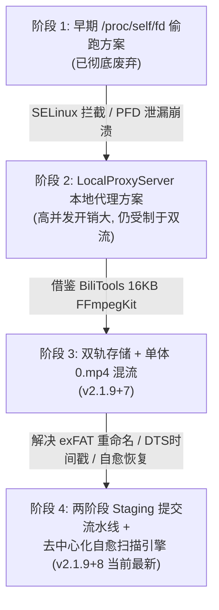

# PiliPlus for SDCard - 项目背景与核心架构记忆库 (Project Memory & Architecture Heritage)

> **文档标识**: `PROJECT_ARCHITECTURE_BACKGROUND_MEMORY.md`  
> **最后维护时间**: 2026-10-18  
> **基准版本**: PiliPlus v2.1.6.2 (Upstream Commit `b2d6a5bef`)  
> **演进版本**: PiliPlus SD v2.1.9+8 (`com.example.piliplus.sd`)  
> **适用对象**: Antigravity 全体智能体（Leader、Developer、Auditor、Tester）与后续维护者

---

## 一、 业务起源与核心痛点 (Genesis & Problem Statement)

### 1.1 业务背景
PiliPlus 是一款基于 Flutter 构建的高品质哔哩哔哩第三方客户端。原版客户端的离线缓存通常存储在 Android 内部私有存储空间中。然而，对于大容量视频消费群体（特别是使用平板、配备 128G~1TB 外部物理 MicroSD 卡的用户），将几十甚至上百 GB 的高清视频缓存在寸土寸金的机身内部闪存中极不现实，迫切需要将视频安全、稳定地存入**外置物理 SD 卡**或**用户自定义公共目录**。

### 1.2 核心痛点与历史顽疾
在 Android 11~15 (API 30~35) 及鸿蒙 4.2 (HarmonyOS 4.2 / AOSP 12 兼容层) 系统上，实现外置存储面临跨层、跨进程、跨格式的“天堑”：
1. **老顽疾：下载的文件在列表中打不开、黑屏或无声**：
   - 底层视频播放器由 `media_kit` (封装 C/C++ `libmpv`) 驱动。`libmpv` 原生只接受标准 POSIX 文件描述符或路径，无法识别 Android 专有的虚拟树形协议 `content://` URI。
   - B 站视频流采用 DASH（音画分离），包含独立的 `video.m4s` 与 `audio.m4s`。旧方案尝试使用 `edl://` 轨道拼装协议传递给 `libmpv`，在外部慢速 SD 卡上极易出现两轨时间戳撕裂、音画不同步或解码缓冲锁死。
2. **下载残留 M4S 切片，未转码为单体标准 MP4**：
   - 官方 MP4 规范对音频流封装有严格格式校验。B 站的高品质音轨常包含 Hi-Res 无损（FLAC）、杜比全景声（Dolby Atmos / E-AC3）。若仅使用 FFmpeg `-c copy`，由于容器不支持 raw FLAC 会直接报错退出，导致转码中断，残留未混流的 `.m4s` 文件。
   - B 站音视频切片的 DTS 时间戳常存在微小的非单调递增波动，标准 FFmpeg 会将其判定为异常并中止写入。
3. **冷启动与重启后，离线缓存视频完全消失**：
   - 旧代码在启动初始化下载路径时，未正确保持 SAF 树形 URI（`type == 2`），直接将其当作非法路径而错误降级并覆写为内部默认路径，导致重启后应用扫描空的内部沙盒，使得用户以为“视频丢了”。
4. **设置页面中“SD 卡存储”选项失效或置灰**：
   - 旧代码通过 `path_provider` 的 `getExternalStorageDirectories()` 数量判断是否存在外置 SD 卡，但在部分平板（如华为 MatePad）中该 API 初始化返回单条记录，导致选项被直接置灰（`onPressed: null`）。
5. **APP 卸载重装后无法找回历史视频**：
   - 如果元数据存储在应用私有数据库中，APP 一旦卸载，所有记录灰飞烟灭。即便 SD 卡上的视频文件还在，重新安装后也无法恢复离线缓存列表。

---

## 二、 核心架构决策与演进脉络 (Architectural Evolution)

本项目经历四个主要演进阶段，最终确定了当前成熟稳健的双轨存储与两阶段提交架构：



### 2.1 方案演化对比矩阵

| 架构维度 | 阶段 1: `/proc/self/fd` | 阶段 2: `LocalProxyServer` | 阶段 3: FFmpegKit 简单混流 | **阶段 4: 两阶段提交 + 自愈引擎 (当前)** |
|---|---|---|---|---|
| **存储写入模式** | 直接写入 SAF 流 | 直接写入 SAF 流 | 直接写目标路径 | **Stage 1 沙盒高速暂存 + Stage 2 原子提交** |
| **混流策略** | 无混流 (双流 `edl://`) | 无混流 (双流 `edl://`) | 仅 `-c copy` | **自适应两阶段 (copy 失败自动转 AAC) + DTS 纠偏** |
| **播放器对接** | `/proc/self/fd/<int>` (崩溃) | 本地 HTTP 环回代理 (消耗端口) | POSIX 直接直读 | **POSIX 直读 + 零拷贝 `fdclose://$fd` 兜底** |
| **外置 SD 卡支持** | 仅依赖 SAF | 仅依赖 SAF | 依赖系统 API 探测 | **原生底层多卷挂载深度扫描 + 常驻免授权** |
| **卸载后恢复** | 不支持 | 不支持 | 依赖弱校验 | **去中心化自包含目录 (`0.mp4`+`entry.json`) 100% 还原** |
| **FAT32/exFAT 兼容** | 差 | 差 | 一般 (renameTo 经常失效) | **极高 (流式原子覆盖写，完全免疫 renameTo 缺陷)** |

---

## 三、 关键技术构件原理深度拆解 (Deep Dive into Core Components)

### 3.1 自适应两阶段 16KB FFmpegKit 混流引擎 (`MediaMuxerBridge.kt`)

为了保证 100% 的混流成功率并杜绝平板黑屏，混流引擎设计了完备的防御逻辑：

1. **协程互斥锁保护 (`muxMutex`)**：
   - 混流属于密集型 CPU/磁盘操作。`muxMutex` 确保同一时刻仅有一个混流任务执行，避免多任务并发混流竞争 I/O 导致平板内核卡死。
2. **DTS 非单调时间戳平滑参数**：
   ```kotlin
   "-fflags", "+genpts+discardcorrupt", "-avoid_negative_ts", "make_zero"
   ```
   强制 FFmpeg 重新生成 PTS/DTS 时间戳并丢弃损坏数据包，防止因源端时间戳倒流报错。
3. **两阶段自适应回退降级**：
   - **Phase 1 (极速流复制)**：参数 `-c copy -shortest -strict unofficial -movflags +faststart`。耗时极低（数秒内完成），完全无损画质音质。
   - **Phase 2 (智能转码兜底)**：若 Phase 1 失败（如音频为 FLAC/Dolby/E-AC3），立刻清空临时文件，自动切换为 `-c:v copy -c:a aac -b:a 192k -ar 48000`。视频保持拷贝，音频重采样转为 192k AAC，保证 MP4 封装绝对成功。
4. **清理与原子更新**：
   - 混流成功生成 `0.mp4` 后，立即安全删除原始的 `video.m4s` 与 `audio.m4s`，节约用户存储空间。
   - 显式调用 `FFmpegKitConfig.clearSessions()`，防止长期运行造成原生堆内存泄漏。

### 3.2 两阶段 Staging 提交流水线与 exFAT 容错 (`SafStorageBridge.kt`)

在处理外部 SD 卡（特别是经过 SAF 授权的目录）时，Android 系统的 `DocumentFile.renameTo()` 在 **exFAT / FAT32** 文件系统上存在底层 Bug（经常静默返回 `false` 或报错 `Operation not permitted`）。

为此，我们构建了 **Two-Stage Staging Pipeline**：
- **阶段 1 (沙盒高速暂存)**：
  - 音频、视频、封面、弹幕全部先下载至应用私有缓存目录：`appSupportDirPath/download_staging/<avid>/c_<cid>/`。
  - 此阶段拥有 100% 原生 Linux POSIX 权限，网络写入与 FFmpeg 混流均以最大磁盘带宽全速进行，完全避开 SAF 的跨进程 Binder 延迟。
- **阶段 2 (原子流式提交)**：
  - 当且仅当 `0.mp4` 混流成功且 `entry.json` 生成后，才触发原子提交。
  - 对于 SAF 目录：通过 `SafStorageBridge.commitFileToSaf` 逐个文件流式写入目标 DocumentFile。若目标文件已存在，先写入临时流验证大小无误后再覆盖，避开对原生 `renameTo` 的依赖。
  - 提交成功后，物理清理本地暂存目录。

### 3.3 去中心化自包含存储与通用扫描自愈引擎 (`UniversalCacheRecoveryEngine.dart`)

为达成**“APP 被卸载后视频依然在，重新安装选择该目录后立即找回所有视频”**的目标，整个目录结构采用**去中心化自包含设计 (Self-Contained Storage)**。

#### 目录规约：
```
<用户选定的下载根目录>/
  ├── <avid 或 s_seasonId>/            # 页面级目录 (例如: "123456" 或 "s_789")
  │     └── <c_cid 或 episodeId>/       # 单P/单集目录 (例如: "c_654321")
  │           ├── 0.mp4                 # 核心混流产物 (标准 MP4)
  │           ├── entry.json            # 完整任务元数据 (标题/UP主/时长/清晰度等)
  │           ├── cover.jpg             # 视频封面
  │           ├── danmaku.pb            # 二进制弹幕数据
  │           └── <typeTag>/            # (可选) 清晰度子目录 (存放 0.mp4)
```

#### 自愈恢复双层阶梯 (Two-Tier Recovery)：
1. **Tier 1 (元数据恢复)**：
   扫描到 `entry.json` 时，通过 `BiliDownloadEntryInfo.fromLenientJson()` 读取，并校验 `0.mp4` 大小，瞬间恢复为下载完成状态。
2. **Tier 2 (遗留切片修复)**：
   若该目录下发现残留的 `video.m4s` 与 `audio.m4s`，说明上一次下载在混流前被异常杀后台。引擎在扫描时自动启动后台 FFmpeg 混流，将其修复合并为 `0.mp4` 并补全 `entry.json`。
3. **Tier 3 (逆向离线合成)**：
   即便用户不慎删除了 `entry.json`，只要目录下存在 `0.mp4`，引擎会通过文件夹名称逆向解析 `avid` 与 `cid`，自动构造合成条目并重新生成持久化 `entry.json`。

### 3.4 播放器双轨自适应感知与在线回放本地化 (`pl_player` & `VideoController`)

1. **`FileSource` 本地媒体感知**：
   - 检查 `dir/0.mp4` 或 `dir/<typeTag>/0.mp4`。只要存在标准 MP4，无论入参状态如何，均自动判定为单流 MP4 播放模式。
   - 若不存在 MP4（极特殊情况下仅有双切片），安全回退至双流 DASH 播放，保证绝不黑屏。
2. **在线详情页智能本地重定向**：
   - 用户在浏览在线视频页面时，若本地已经下载过该稿件对应清晰度的视频，系统自动识别并优先加载本地文件播放，节省网络流量并提供零缓冲的瞬时起播体验。

---

## 四、 存储类型选择决策树 (Storage Decision Tree)

在设置中心中，应用提供三种存储模式：

```
                    ┌───────────────────────────────┐
                    │       选择下载存储目录        │
                    └──────────────┬────────────────┘
                                   │
         ┌─────────────────────────┼─────────────────────────┐
         ▼                         ▼                         ▼
【模式 0: 本机内部存储】    【模式 1: 外置 SD 卡沙盒】    【模式 2: 自定义 SAF 目录】
 • 路径: context.filesDir   • 路径: getExternalFilesDirs   • 路径: content://...
 • 权限: 默认 POSIX 读写   • 权限: 免授权 POSIX 读写      • 权限: DocumentFile 授权
 • 特点: 速度最快, 随APP    • 特点: 物理 SD 卡扩展, 随APP   • 特点: 用户自由选定位置,
   卸载而清除                 卸载而清除, 免权限弹窗        卸载后永久保留文件,
                            • 推荐: 平板扩展存储首选       可重装找回
```

---

## 五、 智能体开发与排障速查记忆 (Lessons Learned & Pitfalls)

以下是在过去实践中踩过的真实代码陷阱，所有智能体在修改代码时**务必遵守**：

> [!CAUTION]
> **陷阱 1：`defDownloadPath` 只读 Getter 报错**  
> `lib/utils/path_utils.dart` 中 `String get defDownloadPath => ...` 是 getter，严禁在任何地方执行 `defDownloadPath = ...`！如需回退路径，应在局部声明变量（如 `final defaultAndroidPath = ...`）。

> [!WARNING]
> **陷阱 2：`Directory(contentUri).existsSync()` 恒等于 false**  
> Dart 的 `dart:io` `Directory` 和 `File` 只能检查标准 POSIX 路径。遇到 `content://` 开头的 URI，必须通过原生 MethodChannel (`scanSafEntries` 或 `SafStorageBridge`) 进行处理，严禁调用原生 Dart IO 方法，否则会静默失败或抛出异常。

> [!WARNING]
> **陷阱 3：exFAT / FAT32 上 `DocumentFile.renameTo()` 失败**  
> 不要依赖 Android DocumentFile 的 `renameTo` 作为原子提交的唯一手段。必须使用流式写入目标文件验证大小的覆盖写逻辑，彻底规避文件系统限制。

> [!TIP]
> **陷阱 4：FFmpegKit 16KB 页面对齐**  
> 在 Android 15/16 设备上，Android 强制要求所有 `.so` 动态库按 16KB 页面大小对齐。本项目强制采用 `io.github.jamaismagic.ffmpeg:ffmpeg-kit-main-16kb:6.1.7`，严禁擅自退回官方已被废弃且不支持 16KB 的老旧 FFmpeg 依赖。
