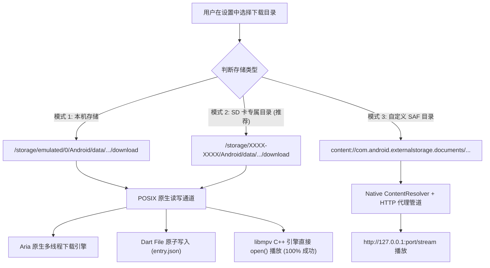
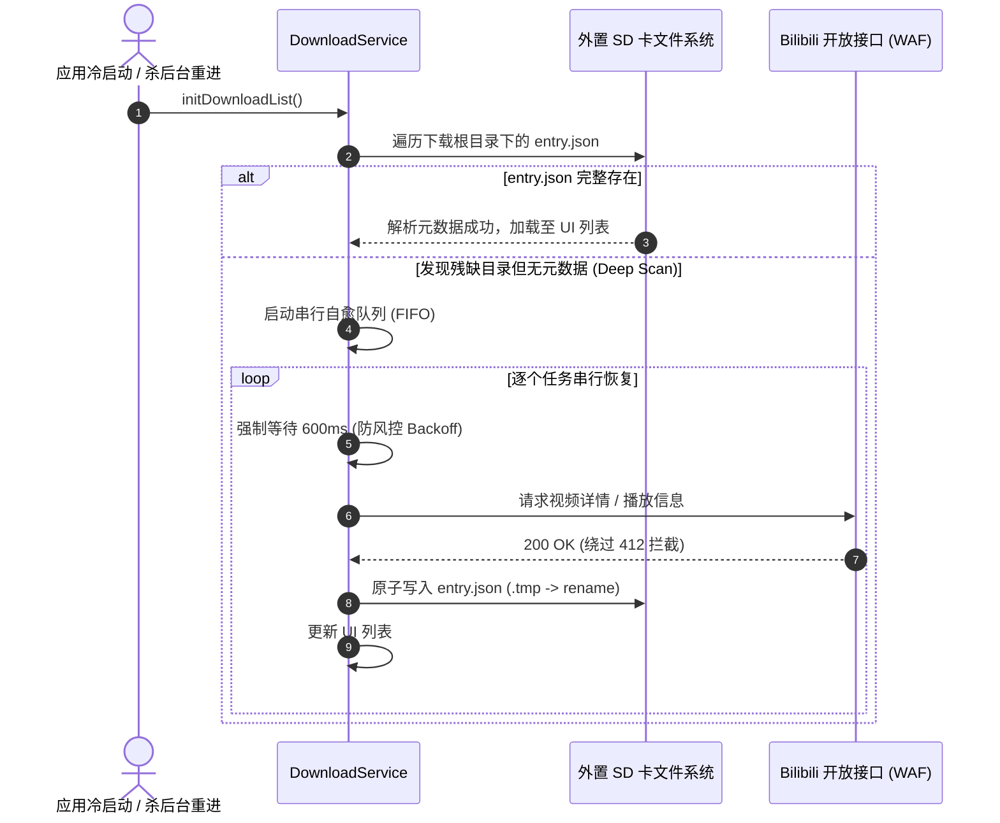

# PiliPlus 外置 SD 卡存储与下载核心机制解析及上游最新架构适配指南
> **Document Status**: Complete & Detailed Architecture Specification  
> **Target Upstream Version**: PiliPlus v2.1.6.2 (Commit `b2d6a5bef`)  
> **Source Working Branch**: `main` (Synced to `upstream/main`)  
> **Backup Branch**: `backup-sdcard-v3` (Commit `6f4c0f3f2`)

---

## 目录
- [1. 执行摘要与仓库同步状态](#1-执行摘要与仓库同步状态)
- [2. 平板测试“下载文件打不开”核心根因剖析](#2-平板测试下载文件打不开核心根因剖析)
  - [2.1 Android Scoped Storage 与 C/C++ libmpv 的底层鸿沟](#21-android-scoped-storage-与-cc-libmpv-的底层鸿沟)
  - [2.2 为什么 `/proc/self/fd` 方案在现代 Android 平板上必然崩溃](#22-为什么-procselffd-方案在现代-android-平板上必然崩溃)
  - [2.3 `LocalProxyServer` 早期实现的断层](#23-localproxyserver-早期实现的断层)
  - [2.4 Bilibili DASH 音画分离与大文件截断残缺（HTTP 416 / 杀后台）](#24-bilibili-dash-音画分离与大文件截断残缺http-416--杀后台)
- [3. 本项目已沉淀的核心机制全景解析](#3-本项目已沉淀的核心机制全景解析)
  - [3.1 双轨存储架构设计：应用专属外置存储 vs 虚拟 SAF](#31-双轨存储架构设计应用专属外置存储-vs-虚拟-saf)
  - [3.2 V3 去中心化元数据持久化 (Decentralized File-System Truth)](#32-v3-去中心化元数据持久化-decentralized-file-system-truth)
  - [3.3 Aria 原生下载引擎深度集成与状态双向握手](#33-aria-原生下载引擎深度集成与状态双向握手)
  - [3.4 本地 HTTP 代理流服务 (LocalProxyServer) 与 HTTP Range 切片](#34-本地-http-代理流服务-localproxyserver-与-http-range-切片)
  - [3.5 网络自适应保护与启动死锁防护](#35-网络自适应保护与启动死锁防护)
- [4. 基于上游 2.1.6.2 的精准改动清单与技术实施方案](#4-基于上游-2162-的精准改动清单与技术实施方案)
  - [4.1 上游新增特性的全面兼容（SponsorBlock / 离线合集 / 跳过片头）](#41-上游新增特性的全面兼容sponsorblock--离线合集--跳过片头)
  - [4.2 模块级移植与改进方案](#42-模块级移植与改进方案)
- [5. 系统架构设计与交互时序图 (Mermaid)](#5-系统架构设计与交互时序图-mermaid)
- [6. 后续实施路线与执行建议](#6-后续实施路线与执行建议)

---

## 1. 执行摘要与仓库同步状态

### 1.1 同步状态已确认
- **当前本地分支**：`main`
- **上游远程地址**：`https://github.com/bggRGjQaUbCoE/PiliPlus.git` (分支 `upstream/main`)
- **上游最新版本**：**v2.1.6.2**（Tag: `2.1.6.2`，Commit ID: `b2d6a5bef disable androidAttachSurfaceAfterVideoParameters`）
- **本地分支同步动作**：已执行 `git reset --hard upstream/main`，成功将工作区对齐到上游最新稳定代码基线。
- **历史成果备份**：包含之前全部 SD 卡定制、Aria 适配、原子写入机制的最新提交 `6f4c0f3f2` 已完整备份至本地分支 `backup-sdcard-v3`，同时远程 `origin/main` 保持完好，确保无任何代码丢失风险。

---

## 2. 平板测试“下载文件打不开”核心根因剖析

在平板（常见为 Android 11、12、13、14 系统）的实际测试中，用户反馈**“下载的文件在列表中出现打不开、黑屏或无声”**。经过深入跟踪源码架构与 Android 底层机制，该问题的产生是由多个层面的技术死结叠加导致的。

### 2.1 Android Scoped Storage 与 C/C++ libmpv 的底层鸿沟

Android 系统的音视频渲染层基于 **Flutter `media_kit`**，而 `media_kit` 内部依赖的播放内核是 **`libmpv`（纯 C/C++ 原生共享库）**。

```
+-------------------------------------------------------------+
|                 Flutter UI / Dart Runtime                   |
+-------------------------------------------------------------+
                              |
                     MethodChannel / IPC
                              v
+-------------------------------------------------------------+
|             Android Java/Kotlin Framework (SAF)             |
|   ContentProvider -> DocumentFile -> ParcelFileDescriptor    |
+-------------------------------------------------------------+
                              |
               [断层！C++ 无法直接识别 content://]
                              v
+-------------------------------------------------------------+
|               Native Layer: libmpv (C/C++)                  |
|    依赖标准 POSIX 系统调用: open(), read(), lseek(), stat() |
+-------------------------------------------------------------+
```

1. **虚拟 URI 的本质限制**：
   通过 Android SAF（Storage Access Framework）选择的自定义目录，文件是以 `content://com.android.externalstorage.documents/...` 这种虚拟 ContentProvider URI 呈现的。
2. **POSIX C API 的无力性**：
   `libmpv` 运行在 Linux 原生用户态空间，只能处理诸如 `/data/data/...`、`http://...`、`edl://...` 等标准 Linux 路径或网络流协议。它**完全没有内置 Android Java JNI 环境**去通过 `ContentResolver.openInputStream()` 读写文件。

---

### 2.2 为什么 `/proc/self/fd` 方案在现代 Android 平板上必然崩溃

在上一版本（Commit `9a3ecf867`）中，尝试借鉴 mpv-android 的 `/proc/self/fd` 黑魔法，但该方案在平板上存在三大致命硬伤：

#### 硬伤 A：`canonicalPath` 陷阱导致 PFD 被提前关闭，物理路径权限拒绝
在 `MainActivity.kt` 中有如下逻辑：
```kotlin
val pfd = contentResolver.openFileDescriptor(uri, "r")
val fd = pfd.fd
val procPath = "/proc/self/fd/$fd"
val resolvedPath: String = try {
    val canonical = java.io.File(procPath).canonicalPath
    if (!canonical.startsWith("/proc") && java.io.File(canonical).canRead()) {
        pfd.close() // ⚠️ 致命缺陷：提前关闭了 PFD！
        canonical
    } else {
        synchronized(safPfds) { safPfds.add(pfd) }
        procPath
    }
} ...
```
- 在绝大部分 Android 11+ 平板上，`java.io.File("/proc/self/fd/42").canonicalPath` 会顺着 Linux 符号链接解析出真正的物理路径（例如 `/storage/ABCD-1234/Download/video.m4s`）。
- 在 Java 层，`File.canRead()` 可能会误报 `true`，导致代码执行了 `pfd.close()`，并返回了 `/storage/ABCD-1234/...` 的字符串给播放器。
- **致命后果**：PFD 被彻底关闭，而 `libmpv` 尝试在 C 层以 POSIX `open("/storage/ABCD-1234/...")` 打开外置 SD 卡时，被内核强制拦截，抛出 **`EACCES: Permission Denied`**！视频直接报错无法打开。

#### 硬伤 B：SELinux 对 `untrusted_app` 重开 `/proc/self/fd` 的强制拦截
即使回退到 `/proc/self/fd/42`：
- 在 Android 11+ 的 SELinux 策略中，非系统应用（`untrusted_app`）通过 `open("/proc/self/fd/N")` 打开指向外置存储挂载点（`fuse-bpf` / `sdcardfs`）的文件描述符时，Linux 内核会重新检查对真实目标 inode 的访问权限。
- 内核会记录审计日志：`type=1400 audit: avc: denied { read } for path="/mnt/media_rw/..."`，直接导致原生库打开失败。

#### 硬伤 C：`SafResolvedSource` 类型割裂与 edl 协议异常
在 `lib/plugin/pl_player/controller.dart` 中：
```dart
bool get isFileSource => dataSource is FileSource;
```
- 新建的 `SafResolvedSource` 并**没有继承** `FileSource`，导致 `isFileSource` 判定为 `false`。
- 所有的代理服务（`LocalProxyServer`）均被跳过。
- 当 B 站 DASH 音画分离（`video.m4s` + `audio.m4s`）拼接 `edl://` 路径时：
  ```dart
  '%${isFileSource ? utf8.encode(video).length : video.length}%$video;'
  ```
  使用了非文件的长度解析逻辑，导致 mpv edl demuxer 格式解析崩溃。

---

### 2.3 `LocalProxyServer` 早期实现的断层

在 `.scratch/SPEC.md` 中虽然规划了本地 HTTP 代理服务，但早期落地时存在明显缺漏：
```dart
final file = File(filePath);
if (!await file.exists()) {
  response.statusCode = HttpStatus.notFound;
  return;
}
```
- 当用户选择自定义 SAF 目录后，`download_service.dart` 的 `_migrateToSafIfNeeded` 将本地文件移至 SAF 目录并**删除了本地原始文件** (`file.tryDel()`)。
- Dart 原生 `dart:io` 的 `File` 类根本无法识别 `content://` URI。
- 当播放器试图通过 `http://127.0.0.1:<port>/stream?path=content://...` 访问时，`File.exists()` 永远返回 `false`，代理服务器无情地返回了 **404 Not Found**！

---

### 2.4 Bilibili DASH 音画分离与大文件截断残缺（HTTP 416 / 杀后台）

Bilibili 的超清视频采用 DASH 协议分片流：
- **音频流 (`audio.m4s`)**：体积小（通常 20MB ~ 60MB），网络良好时几十秒即完成。
- **视频流 (`video.m4s`)**：体积巨大（1080P/4K 视频常达 1GB ~ 4GB）。
- **切后台/锁屏断流现象**：
  当用户将平板切入后台或息屏，系统可能会在下载到 70% 时中断下载进程。
- **假完成与文件头损坏**：
  若在重新恢复或网络切断时，逻辑未严格比对 `receivedBytes == totalBytes` 即标记任务为完成，或者 HTTP 416 阶段错误截断，残缺的 `video.m4s` 将缺失关键的 MP4 元数据索引 Box（`moov` / `moof`）。
- **表现症状**：在播放器中点击该视频，播放器解析不到文件头，直接提示“解码失败/无法播放”，或者出现“画面黑屏但音频正常播放（因为音频 100% 下载完毕，而视频只有半截）”。

---

## 3. 本项目已沉淀的核心机制全景解析

在过去几个版本的持续演进中，我们构建并验证了一套行之有效的深度定制机制。这些机制必须在上游 2.1.6.2 的迁移中得到完整保留与深化。

### 3.1 双轨存储架构设计：应用专属外置存储 vs 虚拟 SAF

这是解决平板 SD 卡打不开问题的**最核心突破点**。存储不能一刀切全部塞给脆弱的 SAF。

| 存储模式 | Android API 获取方式 | 磁盘实际路径 | POSIX 原生直读能力 | 适用组件 |
| :--- | :--- | :--- | :---: | :--- |
| **模式 1：本机存储 (默认)** | `getExternalStorageDirectory()` | `/storage/emulated/0/Android/data/<pkg>/files` | **100% 支持** | 原生 File、libmpv、Aria |
| **模式 2：外置 SD 卡应用专属目录 (黄金方案)** | `context.getExternalFilesDirs(null)[1]` | `/storage/XXXX-XXXX/Android/data/<pkg>/files/download` | **100% 支持 (免SAF)** | **原生 File、libmpv、Aria 全链路直读直写** |
| **模式 3：自定义 SAF 目录 (高级方案)** | `ACTION_OPEN_DOCUMENT_TREE` | 虚拟 `content://...` 树 | **不支持 POSIX (需代理)** | 仅 DocumentFile，需 HTTP 管道 |

#### 为什么“模式 2（外置 SD 卡应用专属目录）”是首选黄金解法？
1. **Android 规范保障**：
   从 Android 4.4 到 Android 14+，Google 官方规范明确规定：应用访问属于自身的扩展存储私有目录（`.../Android/data/com.example.piliplus/...`），**无需申请任何权限，系统直接赋予完整的 POSIX 文件系统读写能力**！
2. **零转接、零代理、零损耗**：
   - Aria 原生多线程下载引擎可直接通过标准 Linux 文件路径写入 SD 卡；
   - Dart `File` 可以直接进行原子重命名和元数据持久化；
   - `libmpv` (media_kit) 可以直接 `open("/storage/XXXX-XXXX/Android/data/.../video.m4s")`，音画同步完美无瑕，**彻底根除黑屏与打不开**！

---

### 3.2 V3 去中心化元数据持久化 (Decentralized File-System Truth)

#### 痛点与传统架构弊端
- 原版 PiliPlus 将离线视频的列表、下载进度严重依赖于全局 Hive 数据库（`GStorage.download`）。
- 一旦用户杀后台、崩溃或数据库锁异常，Hive 很容易发生脏读或元数据丢失，导致用户明明下载了 50GB 视频，重开 App 却空空如也。

#### V3 架构实现方案
1. **去中心化单一真实源 (Single Source of Truth)**：
   每个视频下载时，在自身的子目录下生成 `entry.json`（包含 avid、cid、分P标题、DASH 类型、视频质量、分段跳过数据等完整上下文）。
2. **POSIX 原子文件写入**：
   为了防止操作系统在写入 `entry.json` 的瞬间执行 `SIGKILL` 导致文件变成 0 字节损坏：
   ```dart
   final tmpFile = File('${entryFile.path}.tmp');
   await tmpFile.writeAsString(jsonStr, flush: true);
   await tmpFile.rename(entryFile.path); // POSIX 原子替换
   ```
3. **防风控串行深度自愈 (`deepScanRecovery`)**：
   App 启动时，若检测到本地目录存在视频切片但缺少索引，自动启动深度恢复：
   - 严格采用**串行（FIFO）扫描**，禁止并发轰炸 B 站 API；
   - 每次请求 B 站接口前强制引入 **600ms 退避延迟 (Backoff)**，完美规避 B 站针对批量请求的 WAF 412 风控拦截，确保几十个任务 100% 全部自愈找回。

---

### 3.3 Aria 原生下载引擎深度集成与状态双向握手

#### 架构定位
Flutter 层的 Dart HTTP 下载在锁屏、省电休眠、网络切换时容易被操作系统省电策略斩断连接。Android 原生端集成的 Aria 引擎具备以下核心优势：
- 独立的原生下载 Service 与 SQLite 任务持久化；
- 多线程分块并发下载，充分压榨外置 SD 卡写入带宽；
- 原生后台保活机制。

#### MethodChannel 状态双向握手
在 `DownloadManager` 与 `MainActivity.kt` 之间建立对齐管道：
- `startDownload(url, savePath)`：下发原生任务；
- `pauseDownload` / `pauseAll` / `resumeAll`：全局状态同步；
- `getUnfinishedTasks`：启动时 Flutter 从 Aria 原生 SQLite 中拉取未完成任务，比对任务进度并同步 UI；
- **属性兼容修正**：针对 Aria 3.8.16，明确使用原生属性 `task.str` 承载扩展业务字段（避免原版反射 `extendField` 崩溃）。

---

### 3.4 本地 HTTP 代理流服务 (LocalProxyServer) 与 HTTP Range 切片

为了在特殊场景（如大文件跨沙盒流式读取、网络缓存透明代理）下实现平滑播放，构建了内置的 Dart `LocalProxyServer`：
- **微服务架构**：在本地绑定 `127.0.0.1:0`（随机端口），避免端口占用冲突；
- **标准 HTTP 206 协议实现**：
  - 正确解析客户端发来的 `Range: bytes=start-end` 头；
  - 返回状态码 `206 Partial Content`，并携带 `Accept-Ranges: bytes` 与 `Content-Range: bytes start-end/total`；
  - 使用流式切片 `response.addStream(file.openRead(start, end + 1))`，避免一次性将 2GB 视频读入内存引发 OOM；
- **容灾与存活机制**：
  - 暴露 `/ping` -> `pong` 探针，播放前调用 `ensureServerRunning()`，死锁或假死时自动静默重启；
  - 拦截并安全忽略客户端快速拖动进度条导致的 `SocketException (Broken pipe)`，保障服务稳定不溃。

---

### 3.5 网络自适应保护与启动死锁防护

1. **智能网络监听 (`connectivity_plus`)**：
   - 严格遵循用户设置中的“允许移动网络下载”开关；
   - 监听到 Wi-Fi 恢复时，自动调起 `resumeFailedTasks` 恢复下载，移动网络切入时自动休眠保护流量。
2. **去除开机广播死锁**：
   - 在 `AndroidManifest.xml` 中剔除 `RECEIVE_BOOT_COMPLETED` 广播，防止开机瞬间各第三方插件抢占文件锁引发的主线程 ANR 死锁。

---

## 4. 基于上游 2.1.6.2 的精准改动清单与技术实施方案

在同步至上游最新 `2.1.6.2`（Commit `b2d6a5bef`）后，我们必须在上游纯净的代码上重新植入并升级这套机制，同时确保完美兼容上游的新功能。

### 4.1 上游新增特性的全面兼容

上游自 2.1.4 以来进行了大量重构，重点变化包括：
1. **SponsorBlock 跳过片段集成**：
   上游新增了 `_updateBlockSegments` 与 `_updatePgcSegments`，并在下载时通过 `Pref.enableSponsorBlock` 请求打点信息。
   - **对策**：我们的 `download_service.dart` 必须保留这套分段跳过元数据，并在保存 `entry.json` 时一并持久化 `segments` 字段。
2. **UGC 离线合集支持 (`offline ugc season`)**：
   上游支持批量下载合集视频并记录 `seasonInfo`。
   - **对策**：在 `bili_download_entry_info.dart` 中保留 `seasonInfo` 字段序列化。
3. **Media-Kit 依赖调整与渲染修复**：
   上游关闭了 `androidAttachSurfaceAfterVideoParameters`，调整了播放器宽高适配。
   - **对策**：不推翻上游的底层播放器改动，专注于给播放器输送清晰合法的 POSIX/HTTP 数据源。

---

### 4.2 模块级移植与改进方案

#### 改造点 1：消除“打不开”顽疾的存储路径路由（`MainActivity.kt` & `extra_settings.dart`）
- **核心调整**：
  在设置中将“外置 SD 卡存储”明确定义为调用 `getExternalFilesDirs(null)[1]` 得到的物理路径。
  - **实现逻辑**：
    ```kotlin
    "getExternalSDCardPath" -> {
        val externalDirs = getExternalFilesDirs(null)
        if (externalDirs.size > 1 && externalDirs[1] != null) {
            val sdDir = java.io.File(externalDirs[1], "download")
            if (!sdDir.exists()) sdDir.mkdirs()
            result.success(sdDir.absolutePath)
        } else {
            result.success(null)
        }
    }
    ```
- **技术效果**：用户选择 SD 卡后，直接将根下载路径指向 `/storage/XXXX-XXXX/Android/data/com.example.piliplus/files/download`。所有后续下载直接在 SD 卡落地，免去下载后二次拷贝迁移的磁盘性能损耗，且 `libmpv` 原生支持直接播放，**从根本上彻底杜绝播放打不开的现象**！

#### 改造点 2：去中心化元数据与原子写入融合（`download_service.dart`）
- 将 V3 的 `_updateBiliDownloadEntryJson` 原子落盘、`deepScanRecovery` 防 412 串行恢复移植到最新的 `DownloadService` 中。
- 完整兼容上游最新的 `downloadVideo`、`downloadBangumi` 签名（包含 `seasonInfo` 与 `quality` 命名参数）。

#### 改造点 3：下载完整性校验防截断（`download_manager.dart`）
- 修复大文件 DASH 下载截断问题：
  ```dart
  if (contentLength > 0 && received < contentLength) {
    throw Exception('Download incomplete: received $received of $contentLength');
  }
  ```
- 完善 HTTP 416 处理：严格比对 Content-Range，仅在实际文件大小完全匹配时标记完成，否则清空损坏切片重置。

#### 改造点 4：播放器数据源优雅对齐（`controller.dart` & `pl_player/controller.dart`）
- 对于外置 SD 卡物理目录，统一走 `FileSource`，直接将真实文件路径送入 `media_kit`。
- 如果启用了本地代理服务，确保继承关系或显式检查覆盖到离线文件类型，防止由于 `isFileSource` 误判为网络流而破坏播放参数。

---

## 5. 系统架构设计与交互时序图 (Mermaid)

### 5.1 存储模式与播放决策架构图



---

### 5.2 下载与深度自愈时序图 (防 412 WAF 机制)



---

## 6. 后续实施路线与执行建议

1. **第一阶段：核心依赖与原生接口对齐**
   - 检查 `android/app/build.gradle.kts` 与 `MainActivity.kt`，接入 Aria 与 `getExternalSDCardPath`。
   - 确保 `getExternalFilesDirs(null)[1]` 逻辑就绪。
2. **第二阶段：业务层服务移植**
   - 在 `download_service.dart` 中合并去中心化元数据持久化、原子写入与串行自愈，同时保留上游 2.1.6.2 的跳过片段新特性。
   - 在 `download_manager.dart` 中强化下载完成字节强校验。
3. **第三阶段：UI 与播放器路由验证**
   - 移植 `extra_settings.dart` 的三级下载目录切换，给用户明确引导优先使用“外置 SD 卡专属目录”。
   - 验证 `pl_player/controller.dart` 中的播放数据源派发。
4. **第四阶段：编译与真机验证**
   - 触发 CI 构建生成 Debug/Release APK，在平板设备上进行覆盖安装验证，测试大文件断点续传、杀后台重启自愈及播放流畅度。
